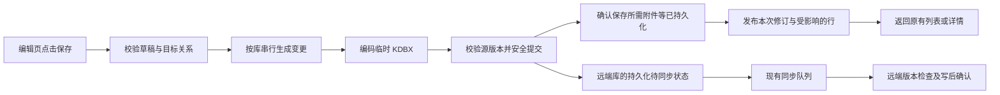

# Monica KDBX 保存流程设计

日期：2026-10-30。状态：本地保存第一批已实施并完成兼容回归；完整设计的性能目标尚未验收。普通版与 canonical F-Droid 仍为 1.0.323 未发布。

目标是让用户在 Monica 原有编辑页保存同一份 KDBX 时，等待接近必要的编码与安全写入时间。界面继续使用 Monica 的密码列表、详情、编辑和附件组件。普通编辑不必承担全库重建与云端往返的全部等待。

## 当前实施范围

已落实按原条目 ID 和关联副本查询，以及从同一个已加载原库取得一致的浏览器和工作区数据。未变化的会话可复用投影；新修订在 UUID 唯一、前后均无 REF、原条目对象和分组/回收站上下文未变化时，复用该条目的密码解析结果。外部重载、REF 或歧义 UUID 回退完整密码解析；最终行值相同则保留其对象。浏览器、安全项、照片恢复及 Passkey 仍刷新，尚未实现全类型增量投影。跨库目标选择、逐目标写入、副本删除、移动和失败处理算法保持原样。

验证证据见 [本地保存实现记录](../verification/keepass-save-pipeline-323.md) 和 [增量密码投影及竞品对照](../verification/keepass-incremental-save-323.md)。REF 依赖集合更新、其他类型增量投影、远端本地先提交与持久化同步恢复、流式 XML 编码仍为后续阶段。本文件后面的流程图、云同步页面和性能门槛是完整设计目标，不代表全部已经实现。

## 1. 参考项目与证据边界

2026-10-30 阅读以下固定提交的源码。下表是实现参考；后续已安装官方 KeePassDX 4.5.6 libre，在同一公共模拟器上以合成库对照保存，方法和数据单独记录在[增量密码投影及竞品对照](../verification/keepass-incremental-save-323.md)。源码事实本身不能证明竞品耗时或 Monica 提速比例。

| 项目与源码 | 确认的行为 | Monica 的取舍 |
| --- | --- | --- |
| [KeePassDX SaveDatabaseRunnable](https://github.com/Kunzisoft/KeePassDX/blob/25493ea30139adab14d937602f28d5243d3f9ecc/app/src/main/java/com/kunzisoft/keepass/database/action/SaveDatabaseRunnable.kt#L66) | 创建临时文件，调用保存；成功后才标记数据已保存，再通知完成 | 保留真实提交边界，不以点按钮或只更新内存作为成功 |
| [KeePassDX DatabaseOutputKDBX](https://github.com/Kunzisoft/KeePassDX/blob/25493ea30139adab14d937602f28d5243d3f9ecc/database/src/main/java/com/kunzisoft/keepass/database/file/output/DatabaseOutputKDBX.kt#L80) | XML 序列化、压缩、加密和分块校验通过输出流串联 | 第二阶段评估减少完整 XML 字符串和多层字节数组复制 |
| [KeePass2Android SaveDB](https://github.com/PhilippC/keepass2android/blob/8b60a72fc8eb23e8580df053a49ca813a686c838/src/Kp2aBusinessLogic/database/edit/SaveDB.cs#L126) | 在 SyncInBackground 且存储支持离线切换时，先写缓存；FinishWithSuccess 再启动同步 | 借鉴本地提交与远端确认分离；该模式有条件，不能说所有保存都如此 |
| [KeePass2Android CachingFileStorage](https://github.com/PhilippC/keepass2android/blob/8b60a72fc8eb23e8580df053a49ca813a686c838/src/Kp2aBusinessLogic/Io/CachingFileStorage.cs#L394) | 有本地缓存、版本哈希与写事务；部分路径使用 MemoryStream | 借鉴事务和版本管理，不把它描述成无缓冲或全流式实现 |

两者保存仍执行相应的密钥变换。原生 KDF 是其中一环；“原库接入”和“整个文件编解码由原生代码完成”也不同。Monica 当前为 Kotpass 0.10.0 编解码，加 Rust/JNI Argon2d、Argon2id、AES-KDF。

### Monica 已有测量

可复核记录：[原生 KDF 验证](../verification/keepass-native-kdf-323.md)。这些是公共 API32 模拟器 Debug 数据，受宿主负载影响，不是 Release 真机性能承诺。

| 测量 | 普通版 | F-Droid | 含义 |
| --- | --- | --- | --- |
| 300 条测试库直接原库保存 | 405 ms | 522 ms | 已有特定夹具结果，不等于完整编辑页耗时 |
| 真实编辑页 handler 到导航回调 | 4841 ms | 3591 ms | 仍存在明显额外等待，是本设计要解决的问题 |
| 写输出流打开前 / 后 | 2642 / 2199 ms | 1863 / 1728 ms | 粗分界，不能把前段全归为 KDF、后段全归为文件 I/O |

另一轮 2 ms ART 采样中，回调区间约 2591 ms；编码约 887 ms，其中 XML marshal 约 523 ms、KDF 约 337 ms；外部源安全写入约 541 ms。子阶段存在嵌套，不能把这些数直接相加；采样和主线程调度也会影响结果。尚不能解释全部等待，实施第一步必须补直接阶段计时。

### 已确认的调用结构与待证假设

| 位置 | 代码事实 | 设计动作 |
| --- | --- | --- |
| `PasswordViewModel.savePasswordsAcrossTargets` | 保存前后通过 `getAllPasswordEntries().first()` 取全量条目，用于原条目、关联副本等处理 | 用按来源、条目及副本关系的查询缩小范围；测量实际贡献 |
| `KeePassMonicaPasswordStore.load` | 连续调用 `openNativeBrowser` 和 `loadWorkspace`，两个路径都涉及密码数据构建 | 取得一次一致的会话快照，复用分类及投影 |
| `KeePassKdbxService.writeDatabase` | 本地写入后内联调用 `syncRemoteWorkingCopy`；已有 pending change、上传 Worker、哈希和冲突机制 | 复用现有队列，补齐本地提交与同步确认的分界 |
| Kotpass `Encoder.kt` | 完整 XML 字符串及多层字节缓冲参与编码 | 流式编码独立实验，以分配量、峰值内存和真实保存时间决定是否接入 |
| `LocalKeePassDatabase.kt` 的更新计数 SQL | 已有 `entry_count != :count` 条件 | 更正此前推测：相同数量不会更新行，不能说已确认它导致无效写入和界面刷新；仍有 DAO 调用成本待测 |

现有普通保存已关闭额外的完整解码验证，保留文件修订检查和写后校验。本设计不把“去掉重复解码”列为尚待实现的新优化。

## 2. 推荐流程与成功边界

图中的待同步状态与文件写入不能靠一笔 Room 事务实现原子性，具体顺序见第 5 节。返回远端库编辑页前，必须已经持久化可恢复的待同步信息；网络可以稍后完成。

| 库的位置 | 编辑页何时成功返回 | 可显示的文案 |
| --- | --- | --- |
| 应用内部的本地 KDBX | 原文件安全提交及既有校验通过，所有必需本地后续操作成功 | 已保存 |
| 用户通过系统文件选择器打开的 KDBX | 文件提供者写入及既有校验成功 | 已保存到所选文件 |
| Monica 直接连接的远端库 | 加密工作副本提交、校验和待同步恢复信息就绪，必需本地后续操作成功 | 已保存到本机 · 待同步 |

系统文件提供者可能自行连接网盘；Monica 无法控制它的网络等待，也无法由一次 SAF 写成功推断其云端已同步。只有 Monica 自己管理的远端源使用第三种语义。

本地文件提交失败时留在表单，不清空草稿、不导航、不显示成功。提交已完成但附件等后续操作失败时，明确显示“密码已保存，附件未完成”等实际结果，保留未完成部分，重试不能重复创建密码或历史。必须区分“保存失败”和“部分操作已完成”。

## 3. 第一阶段：缩短 Monica 的本地路径

### 3.1 缩小目标查找范围

在 `PasswordViewModel` 和仓库接口中增加按现有稳定标识定位原条目、原生 UUID 映射及关联副本的能力。常见的“编辑一个原库条目，仍存到原库”不读本地、Bitwarden 和其他库的全部密码。

快速路径的条件：单个已解锁、可写 KDBX；来源身份与当前会话一致；保存目标没有变化；没有需要传播的关联副本、跨库移动或其他存储事务。条件不满足仍执行现有跨目标流程，但同样优先改成有范围的查询。不能仅凭“用户只选中一个目标”就断言没有旧副本。

只把定位信息作为查询参数；不得把原库条目投影成 Room 密码内容索引来换取速度。删除旧副本只能发生在所有必需目标保存已确认之后。

### 3.2 一次一致的会话投影

建议在已有会话/投影缓存上提供 `loadMonicaSnapshot` 类接口，由同一个源修订构建浏览器分类、密码行与所需类型信息，避免 `openNativeBrowser` 后再独立 `loadWorkspace`。

接口返回的核心信息为 databaseId、源修订、lockVersion、条目 UUID 映射及 UI 所需行；名称是设计示意，不预先锁定代码类型。发布时同时校验修订和锁版本。复用当前最多两个暖库会话及现有淘汰策略，不另建无限明文缓存。

保存结果应携带已提交修订及明确受影响的 UUID/分组，适配器据此更新原有列表。需覆盖：

- 当前条目，使用它的 REF 条目，关联或组合卡，以及排序、搜索和分组统计。
- 图标池或分组变化影响的其他行；歧义 UUID 和无法确定依赖范围时，回退到该库一次完整重建。
- 锁库、整体锁定、缓存替换或外部源更新时，旧投影立即失效；迟到结果不能重新显示敏感内容。
- UI ID 维持现有临时映射，不写入 KDBX 所有权字段；保留 REF 原文和原始字段。

重建的最小单位是“受影响集合”，不能简单理解为“永远只改一行”。首屏无需等待“全部数据库”的总览索引更新，后者按当前架构在后台完成并防止旧修订覆盖新结果。

### 3.3 保持保存事务完整

现有每库串行写入、草稿修订检查、临时文件、原文件变化检测、恢复副本、目标内容校验及冲突拒绝全部保留。一个普通密码表单提交应仍只产生一次 KDBX 文件提交；有明确跨库操作时分别计数。

保存期间重复点击不增加事务。取消与锁定按提交点区分：写入前可终止；开始提供者写入后，不能把协程取消等同于底层写入已中止或回滚成功。结果不明时先检查文件与恢复副本，再决定重试，禁止叠加另一笔写入。锁定后不发布明文 UI。此设计不延长会话解锁时间，也不改变 Keystore 或恢复策略。

`AddEditPasswordScreen.finishSave` 中 TOTP、关联、图标与暂存附件等按实际依赖分类。必须纳入这次保存的持久化操作继续等待；只有可重建的派生索引才能离开关键路径。没有待处理资产时，`EmbeddedWalletDraftStore.persist` 已有快速返回，不把它列为固定重活。

## 4. 第二阶段：评估流式编码

在第一阶段稳定且新计时仍显示编码占主要成本后，再改造 vendored Kotpass 的编码输出端。优先沿用现有 Kotpass 数据模型、解析器及 native KDF provider；暂不整体更换数据库引擎或引入另一份原生会话模型。

目标管线：现有节点遍历 → XML writer → 压缩流 → 加密流 → HMAC/块输出 → 临时文件。KDBX3/4 按各自格式组织流和头；输出流的包装顺序必须由格式与测试确认，不能直接照搬另一版本的顺序。

兼容条件：

- UUID、历史、附件、未知字段、保护位、自定义图标、REF 原文及条目所有权保持语义一致。
- 保持原 KDF 参数、每次保存所需的随机材料、保护字段的流顺序与加密格式；不缓存变换后的主密钥来跳过新一轮 KDF。
- 当前 `KeePassXmlContentParser` 使用 pretty XML 是为了绕过上游紧凑序列化丢失纯空白值的问题，并转义 CR。不能直接把 `pretty` 改为 false。先补纯空格/制表符/CR/LF、多行密码和未知 XML 的夹具，再替换 writer。
- 用旧/新 writer 编码后分别重开并比较完整语义；输出含随机数，不能要求两个密文字节完全相同。补 KeePassDX/KeePass2Android 打开并再次保存的互操作检查。
- 通过测试后再观察分配量和峰值内存；只改善微基准但没有改善实际编辑页等待时，不扩大上线范围。

## 5. 远端库：持久化本地保存，复用既有同步队列

复用 `KeePassPendingChangeRepository`、`KeePassPendingFlushPlanner`、`KeePassRemoteUploadWorker`、远端同步状态和每库上传 mutex。当前代码已有版本检查、上传期间本地又修改后的分支和重新入队；本设计把这些能力作为基线，不能宣称从零新增了可靠队列。

### 5.1 文件与待同步状态的崩溃一致性

实施前检查现有待变更表和安全存储能否承载“已准备/已提交”阶段。推荐协议：

1. 在内部加密临时 KDBX 编码完成后，持久化提交意图，关联旧/新文件哈希、现有待变更批次和暂存产物。变更内容沿用受保护存储，不新增明文密码表或日志。
2. 重新检查源修订，安全切换工作副本并完成校验。
3. 在 Room 中把意图及关联变更标记为已提交，更新工作哈希/待同步状态。仅已提交批次允许上传。
4. 发布会话结果并安排现有 Worker。文件、Room 与 WorkManager 不共享事务；恢复时必须能够重新入队。

启动或下次获准解锁时恢复：工作文件匹配新哈希则完成状态登记；匹配旧哈希则保留/清理未提交意图但不上传新版本；两者均不匹配或文件缺失则进入恢复/冲突检查，保留恢复材料，不能标成已同步或直接覆盖。若现有表无法表达，才增加最小提交意图记录，不并存第二套同步任务系统。

### 5.2 本地修订与远端确认分别管理

概念上区分本地修订 L 与已确认远端基线 R。可用现有哈希和版本令牌实现，不要求另造全局递增 ID。

- 每库只有一个网络上传序列。上传捕获不可变的已提交密文及当时远端基线，网络阶段不长期持有本地编辑锁。
- 上传 A 期间又保存 B：A 的确认只能推进远端基线和完成属于 A 的批次，B 继续待同步。不得清空 B、以 A 替换工作文件，或把 B 的页面显示成已同步。
- 上传前检查一次哈希还不够；发布确认和写入合并结果前再次检查。网络合并时以捕获基线操作，结果只有在本地仍匹配时才可安装；否则在最新本地修订上重新处理或保留冲突。
- 可合并尚未上传的密文版本，但保留从已确认远端基线开始的待变更与历史；不能只删旧批次而丢失三方合并依据。
- 原 ETag/版本令牌、远端校验、三方冲突处理继续有效；云端同时修改时保留双方，不默认最后写入者获胜。
- 网络失败、取消、鉴权到期按既有策略等待/重试；锁库与安全访问策略继续约束任务，不因“后台同步”而放宽读取凭据或解密权限。等待解锁时明确显示状态。

普通版适配它已支持的远端源；F-Droid 仅适配自身已支持的源，不增加 OneDrive。SAF 提供者不纳入这条直接上传队列。

## 6. 用户看到的状态

沿用现有 Material 3 Expressive、主题和自定义配色。外侧 12dp，分组外圆角大、相邻圆角小；编辑页保留右下角保存控件。状态放在当前数据库的标题/信息区域，不为每条密码都添加同步徽章，也不新增底部导航。

| 状态 | 显示与操作 |
| --- | --- |
| 编辑中 | 原表单和保存按钮；不新增“性能模式”选择 |
| 正在本地保存 | 原保存控件显示进度并阻止重复提交；不展示伪百分比、不人为延长动画 |
| 本地库保存成功 | 返回原有页面，短暂“已保存”提示 |
| 远端库本地保存成功 | 返回原有页面；数据库处显示“已保存到本机 · 待同步”或“正在同步”，列表可继续用 |
| 同步完成 | 数据库状态变为“已同步”；只对应当前本地修订已获确认的情形 |
| 网络失败 | “已保存到本机 · 同步未完成”，点开底部弹窗查看原因和重试，不要求重新保存密码 |
| 等待解锁/登录 | “待解锁后同步”或“需要重新登录”，沿现有入口恢复授权 |
| 冲突 | “云端也有修改”，说明两边版本已保留，接现有冲突处理入口；不自动覆盖 |
| 本地保存失败 | 保留表单，说明文件权限/空间等可操作原因；重试本地提交 |

Canvas 是状态与布局原型，不是可保存密码的产品。使用虚构账号和掩码密码，正常转移由真实提交/同步结果触发；原型的屏幕选择器可查看成功/失败分支，不模拟网络定时成功。

编辑态、保存态、本地保存完成、远端待同步、同步详情、同步失败、冲突和本地失败共 8 屏，存于普通版忽略目录 `docs/design/keepass-save-pipeline-323/`。本地编辑地址、JSON 与检查截图见该目录 README；文档不引用这些本地截图作为仓库图片。

可访问性要求：状态同时提供文字和图标，触摸目标至少 48dp；TalkBack 分别宣布本地保存与同步结果；大字体可换行、弹窗可滚动；按钮随键盘上移。Canvas 使用 412×892 逻辑画幅演示，原生实现后仍需检查 320dp、小屏、大字体、浅/深主题和实际渲染。

## 7. 验收与实施顺序

### 性能测量

优先使用合成库，不使用个人密码库。记录设备/API/ABI、应用构建类型、库哈希、KDF 参数、存储提供者、条目数、附件体积、缓存冷热及宿主负载。同一设备交替运行旧/新构建，避免一组恰好处于重型编译期间。

拆分记录：点击处理 → 目标定位 → 原库变更 → XML/压缩/加密 → 源检查/恢复副本 → 写入/校验 → 必需附件操作 → 投影发布 → 导航回调 → 第一帧。云端确认独立计时。阶段可嵌套，输出需标出关系；诊断只记耗时、数量及非秘密测试标识。

| 场景 | 检查重点 |
| --- | --- |
| 300 条、暖库、普通单条编辑 | 至少 30 次记录中位数和 P95；首要工作量目标：一次安全文件提交，无全库跨存储扫描、无双重投影 |
| 冷启动/解锁后的首次编辑 | 独立样本，不把必要的读库/KDF 时间混进暖库指标 |
| 5000 条、REF/自定义字段/历史、10 MiB 合成附件 | 列表和搜索一致、内存峰值、GC、文件完整性；单独报告大库预算 |
| SAF 文件与 Monica 直接管理远端库 | 分开测试；直接远端注入离线/慢响应，返回时间应不随上传延迟增长 |
| 同参数、同库、同路径的竞品对照 | KeePassDX、KeePass2Android 固定版本/保存模式；计时到真正文件提交，另外记录页面返回；注明各软件的校验策略差异 |

设计目标而非已有结果：在 300 条暖库夹具中，将“真实编辑页总等待”相对本构建前基线的中位数降低至少 40%；除同次必要安全保存与业务后续操作外，目标查找、投影和导航的合计额外开销中位数 ≤250 ms、P95 ≤500 ms。对固定代表性设备再争取接近 1 秒的普通保存体验；高成本 KDF、慢提供者和大附件不能套统一 1 秒承诺。达不到目标时按阶段证据继续定位，不用提前成功动画通过验收。

### 正确性与失败矩阵

- KDBX3/4、Argon2d/id/AES、不同密码保护位、纯空白/CR、REF、未知字段、历史、附件、图标及重复/歧义 UUID。
- 旧草稿、连续两次编辑、跨库副本/移动、复制与目标部分失败；不能出现源先删、遗漏副本或重复历史。
- 外部文件在编码期间变化，磁盘满，权限撤销，输出流中断，写后内容不符；原库/恢复副本与表单结果一致。
- 锁库、整体锁定、取消和迟到结果；不泄露旧投影、不自动重新解锁。
- 文件切换前后、状态登记前后、Worker 入队前后强杀进程；下次恢复既不漏同步，也不上传未提交产物。
- A 上传时保存 B，A 失败/成功/冲突回调分别到达；只能确认对应批次，B 和新表单不被旧结果覆盖。
- 网络、认证、远端版本冲突和重新登录；保留双方修订，遵守原合并及恢复规则。
- 普通版/F-Droid 共享逻辑一致，各自源能力与安全策略不同；既有 KDBX 回归套件继续通过，新增测试验证真实调用路径。

### 落地批次

| 批次 | 改动范围 | 完成门槛 |
| --- | --- | --- |
| A | 真实编辑页的阶段计时、计数和固定夹具 | 可重复看到并区分额外等待，无秘密诊断输出 |
| B | 有范围的目标查询、单次会话投影、受影响集合更新 | 本地正确性回归通过，实际页面指标改善；先收获这部分收益 |
| C | 本地提交意图恢复、现有队列脱离表单等待、数据库状态与弹窗 | 并发、崩溃与锁定矩阵通过后启用远端新语义 |
| D | 流式 writer 独立原型 | 阶段测量证明有必要，互操作与性能门槛均通过才接入 |

B 与 C 不依赖整体更换 KDBX 引擎。若 B 后编码仍占主要时间，D 可以提前实验，但不能绕过兼容验证。设计阶段交付方案和本地原型；当前第一批的实际范围与验证状态以上方实施记录为准，未声明用户现场已提速。

## 8. 本次设计检查

本地 M3E Canvas 已用独立 project 标识载入，实际预览 8 屏均完成；自动检查未发现省略号截断，浏览器无运行异常。已验证保存到进行中、待同步到详情、详情返回、同步失败重试、本地失败重试 5 条交互。已人工查看编辑页、待同步列表和两类失败页面。冲突处理按钮明确留作既有流程入口，不把未模拟的冲突解决计为已验证。

这只是草图检查，不代替原生 Compose 的可访问性、键盘、滚动或设备回归。设计阶段没有修改生产代码或重新运行 Android 构建与设备测试；实施后的结果单独记录于上方验证链接。上述历史耗时与通过数不作为整个设计已经实现的证据。
