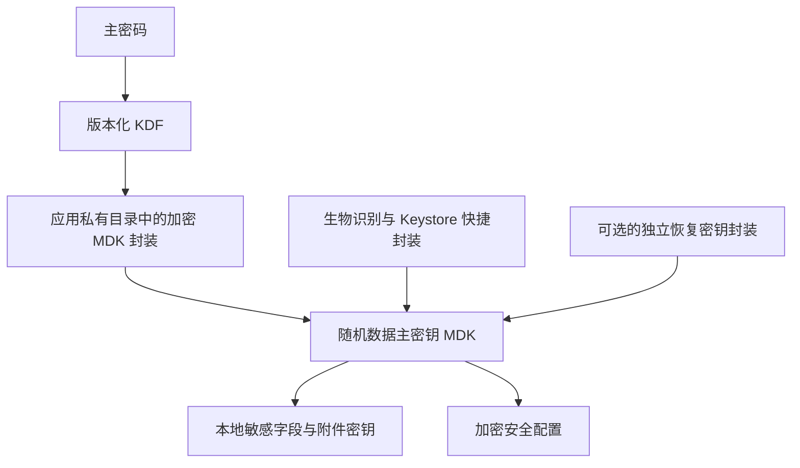

# Android 密钥环境变化：旧数据保护与后续架构审查

核对日期：2026-11-25。对象：普通版和 canonical F-Droid 当前未发布 1.0.331 工作区，包含尚未提交的修改。本轮是源码、历史验证材料与 Android 官方资料审查，没有修改生产代码，没有重新构建、运行 Android 测试、改变 OMK 或操作用户数据库。以下明确区分现有能力、确认的缺口与建议实施项。

## 结论

Monica 应把“系统密钥失效”限制为快捷解锁失效，而不是让它成为普通本地密码数据不可恢复的单点。现有随机 MDK、主密码封装、独立恢复材料、保留原配置和生物绑定修复已经提供基础；但还不能声称全部历史记录脱离设备密钥，也不能声称 Keystore 整体不可用时主密码路径可以完整工作。

建议先完成旧数据盘点、可续跑迁移和可验证备份，再将主密码打开核心库的正常路径与 AndroidKeyStore 解耦。两个阶段分别交付，避免为了新架构一次性重写旧库。

“能登录”“恢复材料验证通过”“全部内容可恢复”“有离机备份”必须作为四个独立事实展示。原随机密钥、其独立封装及可读备份若均永久丢失，软件不能靠主密码重新推导原随机密钥。

## 对截图建议的核对

| 建议 | 判断 |
| --- | --- |
| 不把 Play Integrity/keybox 证明作为开库条件 | 原则正确；当前检查到的本地登录、安全模块与构建依赖没有这种门控，不能把它当作已经确认的故障原因。Passkey 的 WebAuthn attestation 是另一条业务路径。 |
| 主密码独立解密，Keystore/指纹只作便利层 | 应成为目标不变量；当前只完成了一部分：MDK 可由主密码解封，配置正常打开和恢复完成仍使用 AndroidKeyStore。 |
| 明确说明系统密钥异常 | 已有分类和详情弹窗。KeyPermanentlyInvalidatedException 可说明系统报告密钥失效；UnrecoverableKeyException 只能说明无法取出；AEADBadTagException 只能说明认证校验失败，不能独自证明 OMK、keybox、密钥永久删除或密文损坏中的某一种原因。 |
| 修改模块前提示备份 | 应保留，但提醒不能代替恢复能力检查、旧数据迁移和独立备份恢复演练。普通应用也不能可靠预知下一次模块变更。 |

keybox 通常涉及设备/密钥证明材料，和应用 AES 数据密钥不是同一概念；OMK 等模块可能改变 Keystore 请求路由、密钥命名空间或后端可见性。单凭“换过 keybox”不能断言某条 AES 密钥必然改变。历史 TEESimulator 合成测试中，仅切换 keybox A/B 后数据仍可读，切到实际 OMK 路由后才进入恢复流程；该结果仅覆盖当时的模拟器和实现，不能泛化所有 ROM/模块。

## 当前实现与证据

下表路径均相对 Android 工程；行号是本轮工作区的定位点。

| 已有能力 | 源码位置 | 边界 |
| --- | --- | --- |
| 新的正常主密码保护数据使用随机 MDK 的 AES-GCM 加密；已有主密码而 MDK 不可用时拒绝降级写入 | `security/SecurityManager.kt:1575`（位于 `app/src/main/java/takagi/ru/monica/` 下） | 无主密码的兼容路径仍可写 C2；需逐入口核对是否允许新用户使用此模式。 |
| 密码派生密钥封装 MDK，改密保持原 MDK | `security/LocalPasswordCredentials.kt:30`、`security/SecurityManager.kt:420` | 当前密码保护默认 PBKDF2-SHA256/600000；旧 100000 和历史 Argon2id 有版本化读取兼容。更换 KDF 并不能找回丢失的旧随机密钥。 |
| 独立恢复文件加密保存配置快照和密码封装，验证其凭据、修订及 MDK | `security/LocalVaultRecovery.kt:237`、`:458` | 文件位于应用私有数据目录，不是离机备份，也不包含全库可读性结论。 |
| 读取已有 C2/V2 只取原 alias，不因失败创建替代密钥 | `security/SecurityManager.kt:1199` | 不能恢复已经永久丢失的设备 AES 密钥。 |
| 生物重绑定使用新 UUID alias，保留原来可能仍被旧字段使用的 alias | `security/BiometricMdkBinding.kt:15`、`:57` | 需要先验证原主密码和原 MDK；不可用弱包装静默替代认证策略。 |
| 独立恢复先认证，另建配置、读回核验，再切换 selector | `security/LocalVaultRecovery.kt:569` | 保留原配置和恢复材料，但新配置仍调用 AndroidKeyStore。 |
| 已有 C2/V2 后台迁移，逐值解密、MDK 重加密、读回，按原值比较更新；失败保留原值 | `security/PortableLocalCipherMigration.kt:35`、`security/PortablePreferenceCipherMigration.kt:12` | 不等于已完成全量迁移；没有汇总所有剩余项目、失败和排除项的产品状态。 |
| 解密错误分类、备份失败不伪报完整成功 | `ui/model/PasswordReadFailure.kt:10`、`utils/PortableSecretExportPolicy.kt:12` | 错误分类不是根因鉴定；完整便携备份依然需要能读到所有被导出的敏感值。 |

本轮对上述相关的 15 个共享实现文件进行了哈希核对，普通版与 F-Droid 规范化换行后均一致；接线和各平台特有实现没有按“同名即相同”推断。

历史证据已经覆盖部分实际 329→331 R8 覆盖升级、真实 OMK 双向切换、旧读/新写/冷启动及系统入口。这说明已有恢复路径在指定前提下工作，不代表今天的全部工作区、每个历史数据格式或用户设备已重新验收。历史报告中的失败与未验证范围继续有效。

## 仍需处理的问题

### 1. 恢复材料有效，并不证明旧字段安全

`LocalVaultRecovery.verifyProtection` 解开 recovery key、配置快照和 MDK，核对配置与密钥一致，没有遍历 Room、附件文件、历史密码或所有外部库。C2/V2 数据直接依赖各自原设备密钥，不会因为 MDK 可恢复而自动变得可恢复。

当前 UI 文案本身已限定“恢复材料”，但仅显示这一项不足以让用户判断是否可以安全改变环境。应增加独立的“本地数据保护检查”，明确显示尚未迁移、不可读、未检查、设备专属凭据和最近完整备份。

### 2. 迁移触发与分类存在可确认的缺口

`MainActivity.kt:1145` 在认证后等待 15 秒，再依次迁移安全配置、主库、偏好、密钥文件及 Steam 库。取消、退出、锁定、设备密钥尚未授权或某一步失败可能留下旧数据；当前日志与返回的变更数不能证明“剩余为零”。这不是指已有分页续跑完全没有实现：已有迁移确实可以跳过坏值、分批和再次扫描，缺少的是统一的覆盖清单及完成证明。

当前读取会 `trim()` 已识别的 MDK/C2/V2 外层空白，而迁移的 SQL `substr(...,1,3)`、`startsWith`、嵌套字段和密钥文件筛选仍要求前缀在第一个字符。对主库密码列使用原 SQL 的合成 SQLite 复现，`C2|...`/`V2|...` 被选中，带前导空格/换行的同类字段被漏选。该结果是筛选器复现，不是 Android 真机加解密复现，也不能用它解释用户日志里已经进入 AES-GCM 后的校验失败。

需要统一有版本的密文识别入口，并在扫描后给出各类剩余数量；普通明文密码的前后空白必须原样保留。未知格式、未知嵌套结构不能因为长得像 Base64 就被改写。

### 3. 当前恢复仍需要一个能工作的 Keystore 后端

`LocalVaultRecovery.kt:586` 与 `:596` 调用 `SecurePreferencesStore.openRaw` 创建和验证新配置；后者在 `SecurePreferencesStore.kt:97` 构造 AndroidX MasterKey，再打开 EncryptedSharedPreferences。

因此当前能力是“凭原密码，在当前可工作的后端建立新的配置”，不是“完全没有 AndroidKeyStore 也能正常打开核心库”。当整个 provider 卡住、无法生成新 key 或配置读取失败，恢复仍可能无法完成。应明确区分：原 alias 隐藏/失效、用户认证尚未满足、provider 暂时故障、provider 整体不可用。

### 4. 无密码兼容路径和旧无前缀格式需要单独治理

`SecurityManager.kt:1596`、`:1608` 仍允许没有主密码的安装写 C2。若产品仍支持这种模式，需要明确其恢复凭据；不能向用户承诺设备密钥丢失后可只靠一个从未设置的主密码恢复。建议新建本地库保存敏感内容前必须完成密码封装，或明确选择独立恢复密钥模式。旧安装先无损引导，不静默拒绝读取或重设主密码。

V1 无前缀格式的兼容解密仍基于历史描述值，失败会返回原字符串（`SecurityManager.kt:1758`）。这是历史兼容债，不应照搬为新设计。它和合法明文/Base64 密码存在识别歧义；应在已知字段语义与认证标签验证成功时迁移，无法确定时保留并标记待核验。不要给正常文本加前缀、不要把解密失败的原密文当作成功明文再封装。所有 V1 导出/迁移入口仍需专门设备验证，本轮不称已完整复现该兼容链。

`encryptData` 上方还存在与现实现不符的“降级 V1”旧注释，实际代码已经拒绝有主密码时降级。应随实现维护清理注释，防止以后按旧注释恢复危险行为。

### 5. 用户个案还不能归因于单一外部因素

提供的 329 日志（330 降回 329）同时记录 C2 和 MDK 的 AEADBadTagException。C2 栈经过 AndroidKeyStore；MDK 格式还可能涉及错误的数据密钥代次、包装或导入映射、历史重建/回退和密文本身不一致。异常不能说明是哪一次操作、哪个模块导致，也不能只用“硬件旧密钥失效”解释全部 MDK 失败。

需保留该分支调查：检查已有密钥代次、升级/降级和导入历史；只在隔离副本及已授权恢复材料上验证候选，绝不在原库中批量试写或重新生成 MDK。修复读取异常提示不能被描述为已恢复用户密码。

## 数据保护覆盖清单

| 数据 | 应独立恢复的材料与验证 |
| --- | --- |
| 本地登录项目 | 所有账号组密码、OTP、自定义隐藏字段、卡片字段、SSH 私钥、备注及相关结构，不只当前显示的主密码。 |
| 历史与回收站 | 所有历史版本与软删除数据；迁移不应改变业务修改时间、归属或触发远端覆盖。 |
| OTP/Steam/内容块 | 既检查外层密文，也检查已知格式内的嵌套密文；Steam 独立库、导入原始数据和凭据都纳入。 |
| 附件 | 文件本体、完整校验与 CEK 包装同时验证；能解开附件密钥不代表每块文件完整。 |
| KeePass/MDBX | 原库及原生语义保持；单独检查保存的开库密码、内置 keyfile 副本、设备密钥标签和远端凭据。记住的密码失效不等于外部 KDBX 文件损坏；仍可尝试其独立密码/keyfile。 |
| Bitwarden | 服务器数据与本地待同步修改、离线缓存、附件上传意图分别处理。重新登录/同步不能替代保留尚未上传的数据。 |
| 软件 Passkey | `PasskeyPrivateKeyStore` 保存的可导出私钥、引用和元数据必须一起保留并做签名验证；不能只导出 Room 中的引用。 |
| 旧硬件 Passkey/外部安全密钥 | 不可导出私钥不能靠复制 alias 转换成可恢复软件密钥。显示“设备绑定”，建议在对应网站增加备用凭据；不自动删除或伪造迁移完成。 |
| 安全设置和文件 | 密码封装、KDF 参数、加密配置快照、selector、generation/revision 及格式版本；授权和会话状态不能作为备份中的可复用登录凭证。 |

## 分阶段实施方案

### 阶段 A：先保护现有数据，保留当前格式

1. 建立只读盘点器，按存储和字段记录“MDK 可读、设备加密可读、不可读、未知格式、未检查、设备绑定”状态。覆盖清单必须包含扫描范围、数量、失败原因类别和源修订；不保存密码/密钥/明文摘要到日志。
2. 建立迁移前恢复点。SQLite 用一致性快照机制，不直接复制活跃 `.db` 而遗漏 WAL。关联附件、配置和 keyfile 分别写入清单并核对字节。快照整体再加独立加密，因为旧数据库中仍可能有未加密元数据或历史明文。恢复点写失败时不开始覆盖旧字段。
3. 使用原密钥解开能读取的旧内容，用独立验证过的同一原 MDK 重加密；候选落盘并重读核验后，按原值/修订条件提交，记录进度。失败、取消、锁定和并发修改均保留旧值，不影响其他健康条目。
4. 迁移可恢复、可暂停、可续跑，在新旧混合状态下仍可安全读取。旧 alias 在所有依赖都核清前不删除；有未知/不可读项目就不能显示“全部迁移完成”。不要要求一次长时间保持前台才能完成。
5. 完成后用仅从密码恢复材料取出的 MDK 做独立完整读取检查，避免测试偷偷使用运行时原密钥或指纹包装。大型附件可以单独明确显示尚未核验，不能把抽样冒充完整检查。
6. 做离机便携加密备份并在没有源安装密钥的隔离环境恢复；数目、结构、旧/新内容和附件都核对后才标记本次备份已验证。

恢复点保留策略必须同时处理改密：旧密码能解开的历史快照不会因为改了当前密码就自动失效。需告知保留范围，不能自动把旧快照作为正常登录回退；新旧副本验证和清理策略单独制定，故障时不自动删唯一副本。

### 阶段 B：主密码成为真正独立的正常开库路径

密码路径从有界、版本化、认证加密的文件中读取 KDF/salt/封装，拿到原 MDK 后打开安全配置和库；不需要先打开 EncryptedSharedPreferences，也不需要先生成一个新的 AndroidKeyStore key。Keystore 故障仅使快捷封装失效，用户输入主密码应仍能正常打开、读取与备份。

应复用现有 envelope/修订/锁定/确认恢复经验，通过受控存储后端抽象迁移，不能只把 SharedPreferences 换成普通 XML。新后端建立为独立候选，验证后切换版本化 selector；旧文件保留。主应用、独立 `:ime`、Autofill、Passkey 和后台任务必须使用相同的授权与代际检查，不允许某个入口绕回硬件必需路径。

新建库必须先原子提交并读回密码封装，才允许第一条敏感数据写入；独立材料创建失败不能显示初始化成功。已有库开启新后端时保持原 MDK，改主密码只更新封装。旧包不认识的新格式需要明确拒绝或只读，不能把新格式误识别成空库；必须测试允许回退的版本边界。

可以后续引入带 vault/key ID、版本及认证上下文的密文 envelope，便于诊断密钥归属和防止错误跨库使用；这需要独立格式迁移评审。当前 `MDK|` 不带这些标识，不要为修复本次问题直接改写所有历史密文。

KDF 当前沿用已验过的版本化 PBKDF2-SHA256/600000。若以后切 Argon2id，应独立评估低内存/OEM/JNI 和升级回退，不把“换 KDF”混同于消除硬件依赖；不得因设备慢静默降低参数。

### 阶段 C：完善故障保全与长期检查

- 普通便携备份继续在不可读字段时拒绝伪报完整成功。另外提供“保存原始加密材料”能力，明确它是保留后续恢复机会，不保证换设备可解密；不得导出 AndroidKeyStore 原始私钥或要求用户提供 keybox。
- 原始保存包应含一致性数据库快照、关联密文文件和原配置/封装/版本/校验清单，并使用独立密码或高熵恢复密钥作外层加密。用户只保存到明确选择的位置，不自动上传。若提供可读部分导出，必须单独标成“不完整”，列出未导出数量并保留原库。
- 故障页显示实际阶段与类别：认证未满足、密钥不可取、系统报告失效、密文认证失败、恢复材料缺失/损坏/未知版本、provider 超时。环境还原只作为条件建议，不自动改 Root 模块。
- 日常显示三项具体状态：主密码恢复材料、旧数据迁移/全量校验、离机备份。状态绑定源修订，新增/导入旧格式后撤销“全量完成”状态，不因登录成功变绿。
- 高熵独立恢复密钥可作为可选第二条路径，必须真正让用户保存到应用之外并验证；不能仅保存于同一个设备 Keystore 中。它不是必须新增的第一阶段前提。

## 不能牺牲的安全边界

密码独立恢复会允许获取加密备份的攻击者离线尝试口令，因此强主密码、合适 KDF、随机 nonce、认证加密、参数解析上限和锁定后的内存清理必须保留。界面限速不能阻止离线猜测。

不要让应用口令、锁屏密码、安全问题和恢复密钥彼此混用；已有忘记密码流程需沿当前明确授权，不能让弱安全问题单独绕过保护。若提供设备绑定高安全模式，应明确它牺牲的是可恢复性，不能默认给普通用户却显示“主密码可恢复”。

应用不能阻止 Root 环境恶意删除所有文件、读取已经解锁的进程内存或破坏所有备份。合理可验收目标是：设备密钥失效不再单独导致已迁移、恢复材料完整的普通本地数据丢失，同时保留独立备份应对文件丢失。

防回滚也有边界：本机 generation/revision 能拒绝不一致或误用旧材料；在无服务器或独立可信状态下，不能保证识别攻击者整体恢复的一致旧快照。不要为自动恢复删除现有防回滚标记，也不要承诺绝对防回滚。

## 实施验收矩阵

| 组别 | 必须验证的场景 |
| --- | --- |
| 实际升级与回退 | 历史 Release 创建混合 MDK/C2/V2/V1 数据，同包同签名 R8 覆盖升级，旧密码、完整旧数据、新写、备份恢复和新 PID 冷读；测试已允许的旧版本回退及格式拒绝。 |
| 密钥环境 | System→OMK→System；alias 缺失/同名异钥；原 alias 可用与不可用；provider 能新建与完全不可用；新密码后端在禁止 AndroidKeyStore 访问时仍可完成普通数据解锁/备份。 |
| 材料故障 | 缺封装、坏标签、截断、错误密码、未知 KDF/版本、损坏 selector、修订不一致；不得显示新建空库或覆盖原材料。 |
| 迁移中断 | 每个持久化阶段进程死亡、磁盘满、I/O 失败、取消、锁定、并发编辑、重复重试、跨进程读取；旧值或已验证新值可用，不出现半记录。 |
| 格式与覆盖 | 前后空白、嵌套旧密文、空密码、未知字段、重复字段、账号组、历史、回收站、附件、内置 keyfile、Steam、软件/硬件 Passkey、Bitwarden 未同步内容。 |
| 恢复独立性 | 新安装/新 Android 用户无源 alias、无源运行时缓存，仅使用用户保存的独立材料还原；不能只在同一进程内加密后立刻解密。 |
| 系统入口 | 主界面、Autofill、独立 IME、凭据提供方、后台备份；退出或超时后迟到结果不可授权。 |
| 真机范围 | MuMu 合成验证后补受影响 Android/OEM/ARM64 真机；未验证的版本、TEE、指纹或模块明确列出，不能据模拟器全绿宣称覆盖。 |

最优先交付是阶段 A 的盘点/迁移完成证明，以及失败时保留原始材料的能力；阶段 B 单独作为安全存储架构变更验收。不要只继续加错误弹窗，也不要直接卸掉 Keystore 或自动重建原 alias。

## 本轮证据与参考

- 本轮本地 `source-audit.json` 保存两仓 HEAD/分支、15 个共享实现哈希及合成 SQLite 筛选复现；未把用户日志原文、真实数据或截图写入本文件。
- 既有实现与实测：[恢复保护验证记录](../verification/secure-recovery-331.md)、[TEESimulator/OMK 实测](../verification/tee-omk-retained-vault-325.md)、[读取及备份修复](../verification/local-data-read-backup-331.md)、[不可读密码说明](../verification/password-read-help-331.md)、[313→330 调查](../verification/legacy313-upgrade-investigation-331.md)。这些是历史证据，不是本轮重跑结果。
- 前一阶段方案：[密钥环境变化的软件恢复方案](secure-storage-recovery-plan.md)。本文件在该阶段基础上分析剩余架构与迁移工作，不将已实现功能重复列为全新功能。
- Android 官方：[Android Keystore system](https://developer.android.com/privacy-and-security/keystore)、[Key attestation](https://developer.android.com/privacy-and-security/security-key-attestation)、[KeyPermanentlyInvalidatedException](https://developer.android.com/reference/android/security/keystore/KeyPermanentlyInvalidatedException)。本轮已读取，Keystore 的不可导出性意味着不能在原设备密钥丢失后再“备份原密钥”。
